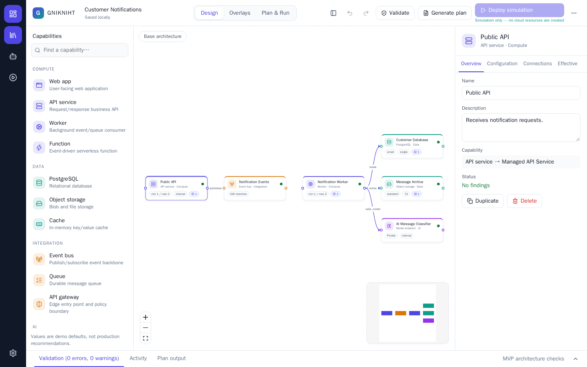
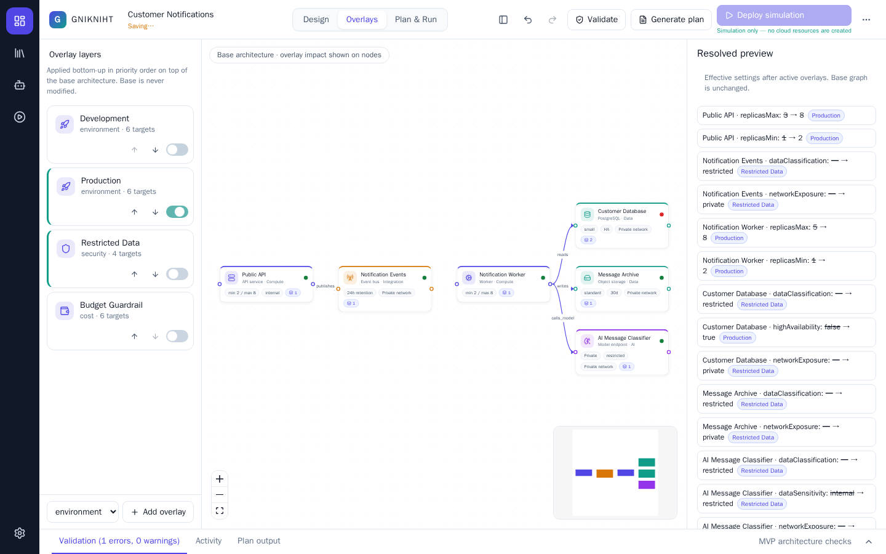
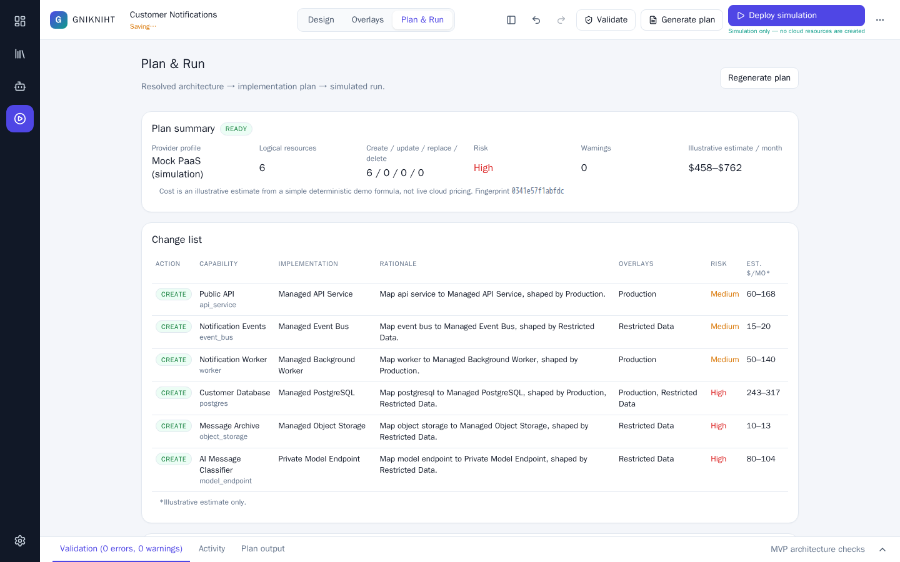

# GNIKNIHT — Intent-Driven Infrastructure Studio

> Design the intent once. Compose the constraints. Let the platform resolve the implementation.

GNIKNIHT is a visual-first studio for modelling an application as a **topology of capabilities and relationships**, layering reusable **overlays** (environment, security, performance, resilience, cost, placement) on top, and resolving the result into a deterministic **implementation plan** with a clearly labelled **deployment simulation**.



> ⚠️ **Simulation only.** This MVP never provisions cloud resources, never asks for credentials and never talks to a cloud provider. Every "deploy" runs against a local mock adapter, and cost figures are illustrative estimates, not live pricing.

## What it is — and is not

| GNIKNIHT is | GNIKNIHT is not |
| --- | --- |
| An architectural topology and intent modeller | A workflow / automation flowchart editor |
| A typed graph as the source of truth | A YAML or Terraform editor |
| Deterministic resolution, validation and planning | A Kubernetes dashboard or cloud console clone |
| An assistant that *proposes* changes you preview and apply | An AI that can edit, bypass policy or deploy on its own |

## Features

- **Design** — drag or click capabilities from the palette (web app, API service, worker, function, PostgreSQL, object storage, cache, event bus, queue, API gateway, model endpoint, external system), connect them with typed relationships (`request`, `publishes`, `subscribes`, `reads`, `writes`, `depends_on`, `calls_model`), move, multi-select, duplicate, delete, pan/zoom, minimap, undo/redo.
- **Inspector** — Overview, Configuration, Connections and **Effective** tabs. The Effective tab shows base vs. resolved values with provenance (base, overlay, platform default, org policy).
- **Overlays** — four demo overlays (Development, Production, Restricted Data, Budget Guardrail), plus your own. Enable/disable, reorder priority, choose targets (all, selected nodes, capability kinds) and edit validated settings. Overlays never mutate the base graph.
- **Conflicts are explicit** — if two overlays set the same property differently, GNIKNIHT reports a conflict instead of picking a winner. Resolve it by disabling a layer or marking the higher-priority overlay as an override with a reason.
- **Validation** — "MVP architecture checks" (edge rules, replica/range checks, production and restricted-data rules, HA support, budget, stale targets, conflicts). Each finding has a **Focus** action; **Explain** uses the demo assistant.
- **Plan & Run** — deterministic plan with input fingerprint, change list, risk and illustrative monthly cost. Plans are **blocked** by errors and become **stale** when inputs change; neither can be simulated.
- **Simulation** — event timeline (queued → validating → provisioning → configuring → healthy) with optional failure injection.
- **Assistant** — a local, rule-based demo assistant (no LLM is connected) that returns a previewable proposal you must explicitly apply.
- **Persistence** — autosaves to browser `localStorage`; JSON import/export; reset demo with confirmation.

| Overlays: Production + Restricted Data | Plan & Run |
| --- | --- |
|  |  |

## Tech stack

React 19 · TypeScript (strict) · Vite · [`@xyflow/react`](https://reactflow.dev) · Zustand · Zod · Lucide icons · Vitest · Playwright · plain CSS with design tokens.

## Install

Requirements: **Node.js 20+** and npm.

```bash
git clone https://github.com/roime81/GNIKNIHT.git
cd GNIKNIHT
npm install
```

## Run

```bash
npm run dev          # development server, http://localhost:5173
npm run build        # type-check + production build into dist/
npm run preview      # serve the production build, http://localhost:4173
```

## Test

```bash
npm test                              # unit tests (resolver, validation, planner, simulation, import/export)
npx playwright install chromium       # one-time browser download
npm run test:e2e                      # end-to-end demo journey + negative path (builds and serves the app itself)
npm run screenshot                    # regenerate docs/screenshots (run `npm run build` first)
```

## Walkthrough

1. Open the app — **Customer Notifications** loads (Development overlay on).
2. Select **Public API**, rename it or change a setting on the *Configuration* tab.
3. Click **Worker** in the palette, then drag from its right handle to **Notification Events** (creates a `subscribes` edge; change the type in the inspector).
4. Open **Overlays** and enable **Production**. With **Development** still on, GNIKNIHT reports conflicts — use *Disable Development* on the conflict box.
5. Enable **Restricted Data**, then inspect any node's **Effective** tab to see which overlay set each value.
6. Click **Validate**. Production's high availability is unsupported on the `small` PostgreSQL tier — use **Focus**, then set the tier to `medium`.
7. Click **Generate plan**, review the change list, risk and illustrative cost.
8. Click **Deploy simulation** and watch the timeline complete. Try *Fail at provisioning* for a failed run.
9. **⋯ → Export JSON** to download the project.

Negative path: change an edge to an invalid type (e.g. `calls_model` → `publishes`) or enable Development and Production together — the plan is blocked with an explanation and simulation stays disabled.

Keyboard shortcuts (ignored while typing): `Delete` delete · `Ctrl/⌘+Z` undo · `Ctrl/⌘+Shift+Z` redo · `Ctrl/⌘+D` duplicate · `Ctrl/⌘+S` save · `Esc` clear selection.

## Import / export

- **Export** (`⋯ → Export JSON`) downloads `<project>.gnikniht.json`, a self-contained, versioned (`schemaVersion: 1`) document with graph, overlays and profile references. Selection and panel state are never included.
- **Import** (`⋯ → Import JSON…`) validates the file with Zod. On any error the current project is kept and an explanatory message is shown.
- Projects autosave to `localStorage` (key `gnikniht.project.v1`) and are restored on reload.

## How the simulation works

`MockPaaSAdapter` maps each capability to a labelled implementation (e.g. `postgres` → *Managed PostgreSQL*) and produces a plan. Executing a plan only generates a deterministic event timeline in memory. A plan is tied to an **input fingerprint** (hash of nodes, edges, enabled overlays, catalog and policy versions; positions are ignored). If the fingerprint changes, the plan is stale and the Deploy button is disabled until you regenerate it.

## Architecture

```
src/
  domain/        pure, UI-free logic: types/Zod schemas, catalog, overlay settings,
                 resolver, validation, planner, simulator  (+ unit tests)
  application/   Zustand store (commands, undo/redo, transient state) and derived selectors
  adapters/      persistence, MockPaaSAdapter (ProviderAdapter), demo assistant provider
  fixtures/      Customer Notifications starter project and overlays
  components/    React UI: shell, canvas, nodes, palette, inspector, overlays, plan, drawer, assistant
  styles/        design tokens and application CSS
e2e/             Playwright journey tests
```

Rules the code follows: the base graph is never mutated by overlay resolution; resolved architecture, findings and plan validity are always recomputed from inputs; domain logic lives outside React components.

## Known limitations

- Simulation only: no real provisioning, credentials, tenants or authentication.
- Costs are an illustrative demo formula; defaults are not production recommendations.
- The assistant is a small rule engine: it supports the customer-notification template and a few overlay suggestions, and says so when a prompt is unsupported.
- Single local project in browser storage; no collaboration, RBAC or audit trail.
- Validation is a set of MVP architecture checks, not a security assessment.

## Extension points

- **Real providers** — implement `ProviderAdapter` (`src/adapters/MockPaaSAdapter.ts`), e.g. an `AzurePaaSAdapter`, behind a separate scoped phase with identity, approvals, secrets management and audit.
- **LLM assistant** — implement `ArchitectureAssistantProvider` (`src/adapters/assistant.ts`). Proposals are validated with Zod and must still go through preview/Apply; add an explicit privacy/consent design before sending project content anywhere.
- **Catalog and rules** — add capabilities in `src/domain/catalog.ts` and checks in `src/domain/validate.ts`; extend overlay keys in `src/domain/overlaySettings.ts`.
